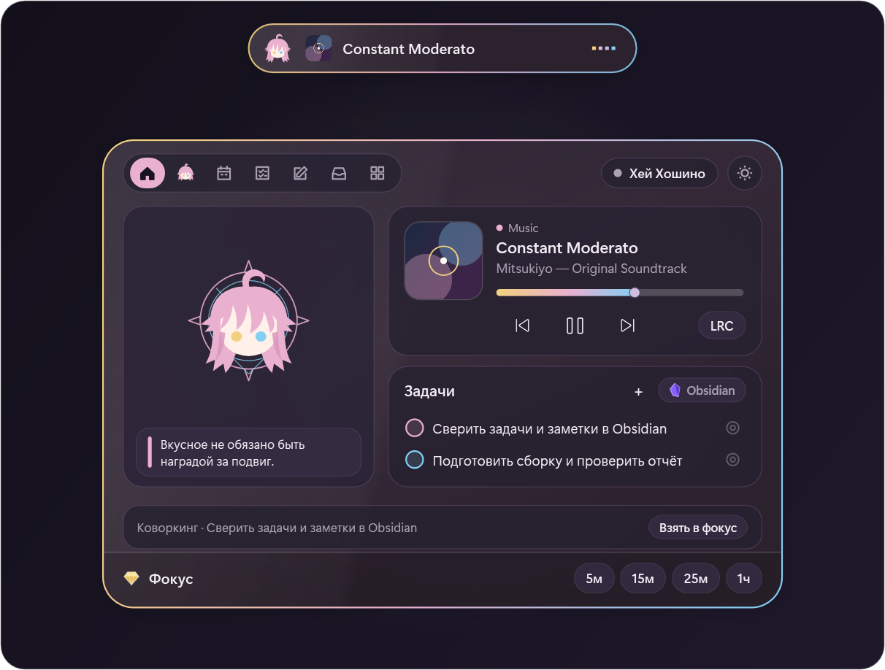
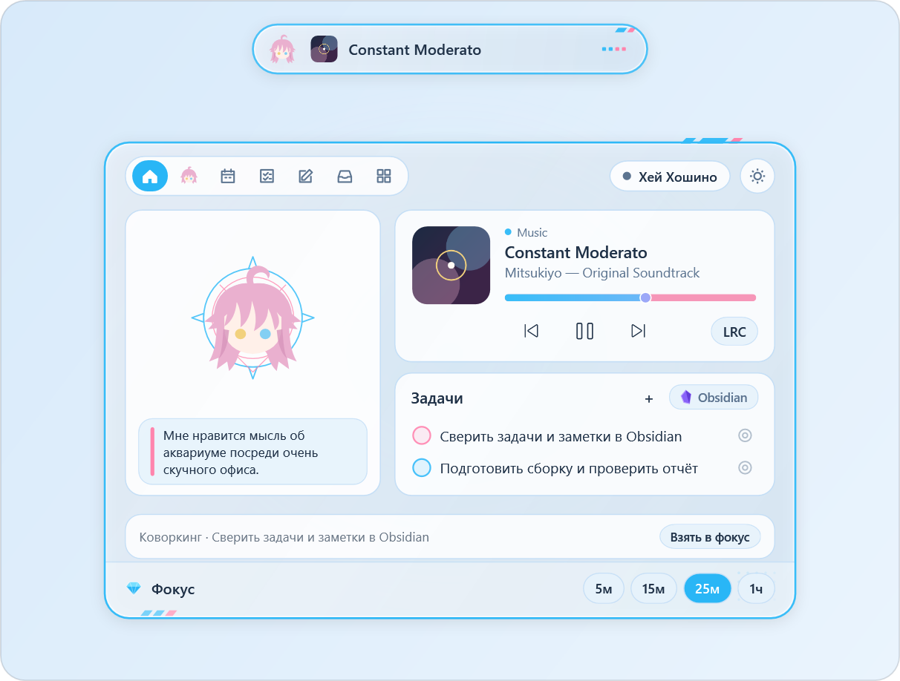
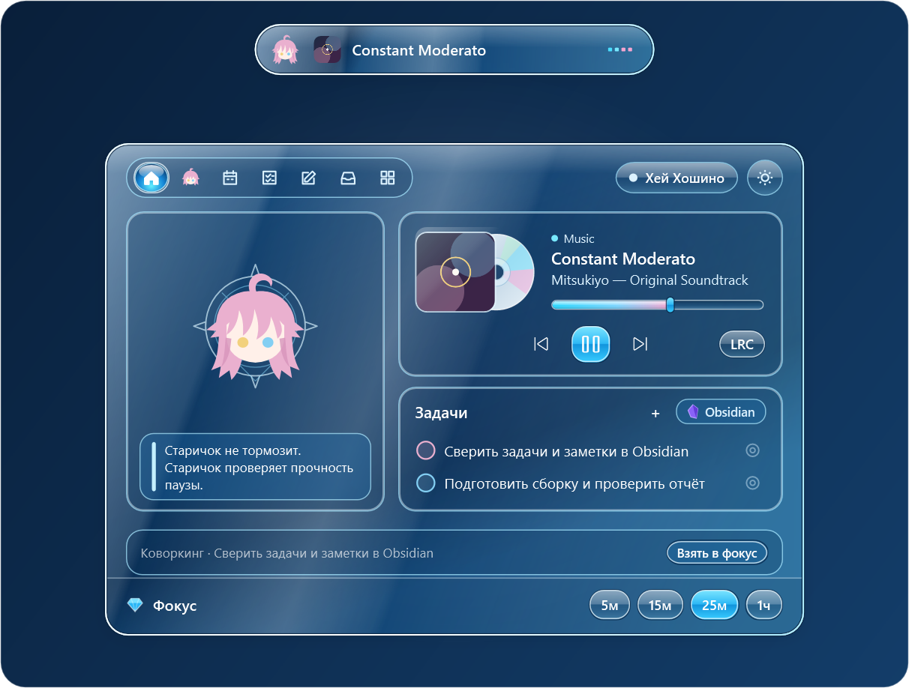
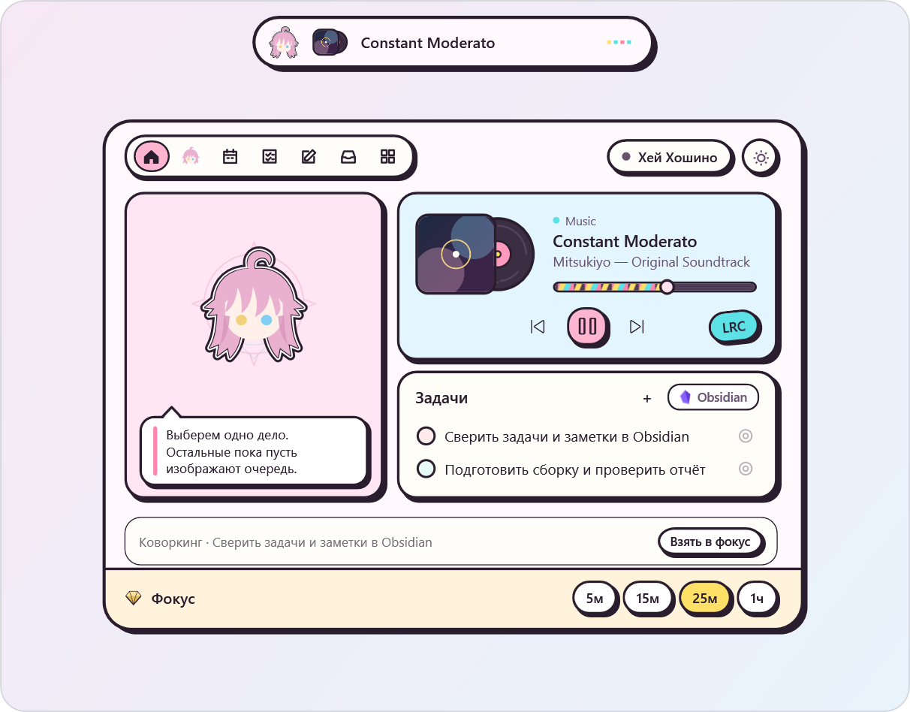
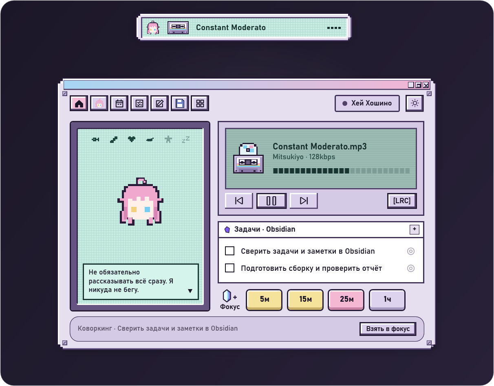
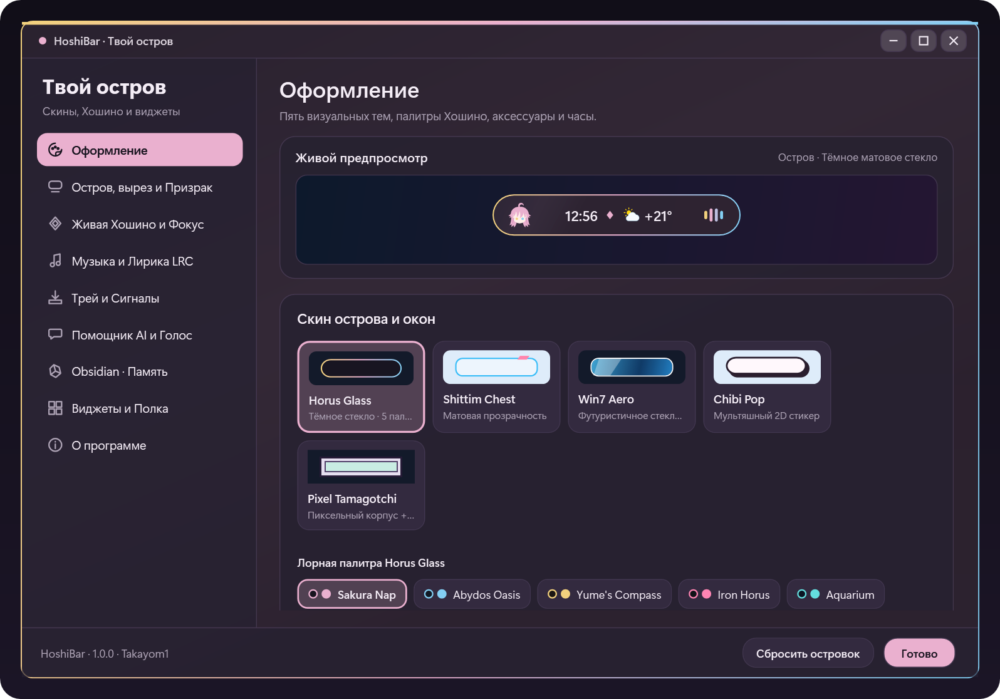
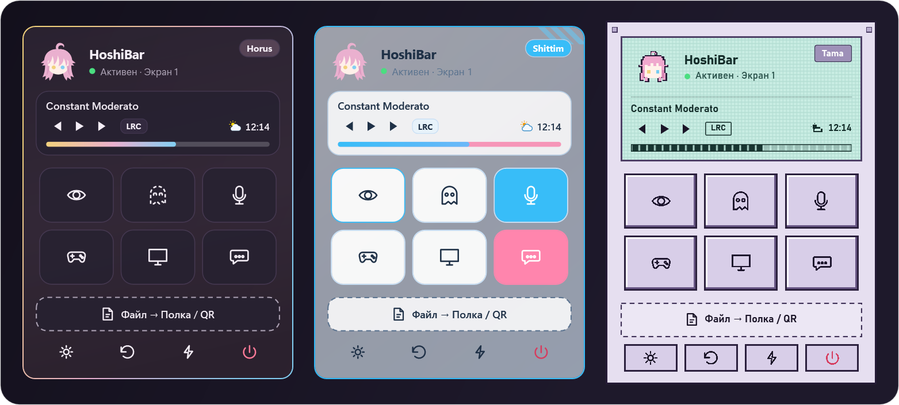
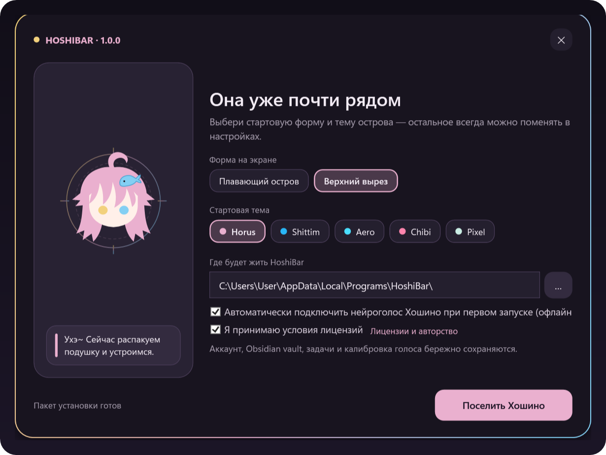

<div align="center">

# HoshiBar

**A smart top-edge bar for Windows 10/11: music with synced lyrics, tasks, Obsidian sync, local Wi-Fi file sharing, and a voice-enabled AI companion.**

[**Русский**](README.md) · [**English**](README.en.md) · [**Releases**](https://github.com/Takayom1/hoshibar/releases) · [**Telegram**](https://t.me/takayom1)

</div>



**HoshiBar** is a native C# / WPF desktop overlay that sits cleanly at the top edge of your screen as a floating capsule or a seamless laptop-style `Notch`. Inspired by Takanashi Hoshino (*Blue Archive*), it brings together media controls, daily tasks, Markdown journaling, phone file transfers, and an AI assistant with a custom vector companion—while keeping a lightweight footprint and stepping aside automatically during fullscreen games.

---

## Visual Themes & Form Factors

Every surface—the bar itself, the two-pane Settings window, and the system tray flyout—adapts on the fly to **5 self-contained themes** across two hull shapes (**Floating Island** and **Top Notch**):

- **`Horus Glass`** *(shown above)* — smoked dark glass with a thin heterochromatic rim and 5 built-in palettes (`Sakura Nap`, `Abydos Oasis`, `Yume's Compass`, `Iron Horus`, `Aquarium`, plus custom `#HEX` colors).
- **`Shittim Chest`** — airy matte sky-blue acrylic inspired by the *Schale OS* tablet aesthetic.
- **`Win7 Aero`** — optical sapphire glass with live DWM blur, convex gel controls, and a peeking CD cover.
- **`Chibi Pop`** — flat 2D pastel sticker style with crisp ink outlines, hard offset shadows, comic callouts, and a vinyl record sleeve.
- **`Pixel Tamagotchi`** — stepped retro shell with a classic window titlebar, sunken mint matrix LCD screen, and a cassette deck.

| `Shittim Chest` | `Win7 Aero` |
| :---: | :---: |
|  |  |
| **`Chibi Pop`** | **`Pixel Tamagotchi`** |
|  |  |

---

## Key Features

### Media Player & Synced Lyrics (`LRC`)
- Connects to any active media session in Windows via `GSMTC` (desktop players, streaming apps, and browsers).
- Displays album art (with optional animated Apple Music artwork), playback progress, and a real-time audio equalizer.
- Automatically fetches time-synced lyrics (`LRCLIB`, `LyricsPlus`, `lrc.red`, `Better Lyrics`) and can show the active line right inside the collapsed capsule.

### Tasks, Journal & Two-Way Obsidian Sync
- **Quick tasks on Home** stay in sync with the dedicated `To-Do` and `Notes` tabs.
- **Calendar & Markdown journal:** view upcoming events (Windows Calendar + `.ics` / `webcal` feeds) side-by-side with a daily Markdown note.
- **Local Obsidian integration:** point HoshiBar at your vault to sync tasks, daily notes (`YYYY-MM-DD.md`), and editable assistant memory in plain `.md` files—with automatic local backups, conflict protection, and zero cloud uploads or Obsidian plugins required.

### Focus Timer & Ghost Mode (`Click-Through`)
- One-click focus presets (`5m`, `15m`, `25m`, `1h`), stopwatch, alarms, single-click task linking for the active session, and a live countdown arc around the capsule rim.
- **Ghost Mode (`Ctrl+Alt+G`):** turns the collapsed bar translucent and passes 100% of mouse clicks and scroll events straight through to browser tabs or IDE toolbars underneath (toggleable indefinitely or for a quick 5-minute timer).

### File Shelf & Local `Wi-Fi QR` Bridge
- Drop files, images, or text onto the bar (or into the system tray flyout) to hold them on the **Shelf** until you drag them into another app.
- Click **Send to Phone (QR)** to spin up an ephemeral 5-minute LAN bridge over your home Wi-Fi: scan the QR code with your phone camera to download shelved files from your PC or upload photos/files straight from your phone to the Shelf—no cloud accounts or cables needed.

### AI Assistant & Updated Auto-Provisioned Neural Voice
- Built-in chat supports local CLI backends for **`Codex`**, **`Gemini`**, and **`Claude`**, featuring streaming replies, local conversation history, and explicit confirmation dialogs (`Iron Horus`) before running untrusted commands or file edits.
- **Voice interaction:** hands-free wake phrase (**"Hey Hoshino"** with quick 3-sample microphone calibration) or push-to-talk dictation via bundled offline `Vosk` or local `faster-whisper`—no microphone audio is sent to cloud transcription services.
- **Updated Neural Voice with Automatic Setup:** Hoshino's upgraded offline neural voice pipeline (`Silero v5_5_ru` + `HoshinoOv2 RVC v2` with `RMVPE` pitch extraction) installs **automatically**. Leave the checkbox checked in the installer (or click install once inside *AI Assistant & Voice* settings with CPU or NVIDIA CUDA mode)—`HoshiBar` automatically provisions an isolated Python 3.11 runtime, `PyTorch`, `Applio`, `faster-whisper`, and voice weights outside the app directory with zero manual Python setup.

### Settings Studio, System Tray & Game Mode



- **Two-pane Settings window** with a live interactive preview, draggable tab order, quick app launcher, `Open-Meteo` weather, and native system OSDs (volume, brightness, device connections, clipboard alerts, mic/camera privacy dot).
- **Icon-only Bento System Tray flyout** with a 6-state dynamic vector tray icon, media/focus bar, one-click monitor switching, and a Shelf/QR drop zone.
- **Multi-monitor & Game Mode:** pin HoshiBar to any display; when a fullscreen game runs on that monitor, the bar hides automatically, pauses animations, and unloads local speech models from RAM/VRAM.



---

## Installation & Requirements



1. Download the latest **`HoshiBar-Setup-*.exe`** from [**Releases**](https://github.com/Takayom1/hoshibar/releases).
2. Pick your starter shape and theme—the installer bundles the `.NET 8 Runtime` and the offline Russian `Vosk` speech model, can automatically set up Hoshino's updated offline neural voice on first launch, installs per-user without admin rights, and preserves your existing settings, tasks, and vault across updates.

**System Requirements:**
- **OS:** Windows 10 (version 2004 / build 19041+) or Windows 11 (`x64`).
- **Optional:**
  - Run the one-time package identity setup from Settings (or `./Identity/setup-identity.ps1 -Restart`) to grant Windows notification and system calendar access.
  - Install the official CLI for `Codex`, `Gemini`, or `Claude` if you want to use AI chat features.
  - No manual Python installation is required: the updated neural voice (`Silero` + `RVC`) and `faster-whisper` are provisioned automatically into an isolated per-user folder when enabled (custom local models remain supported as well).

---

## Building from Source

Requires the **.NET 8 SDK** and **Python 3** (used once before building to fetch and SHA-256 verify the official `Vosk` speech model):

```powershell
python scripts/prepare-speech.py
dotnet restore src/HoshiBar.csproj
dotnet build src/HoshiBar.csproj -c Release
```

Run the compiled binary:

```powershell
& ./src/bin/Release/net8.0-windows10.0.19041.0/HoshiBar.exe
```

---

## Tech Stack & Data Privacy

| Area | Technology |
| --- | --- |
| Core & UI | C#, .NET 8, WPF, Win32 / WinRT APIs, DirectComposition (`Vortice`) |
| Media, Calendar & Audio | Windows `GSMTC`, `Ical.Net`, `NAudio` |
| Voice & AI | `Vosk`, `System.Speech`, local bridge for `faster-whisper` / `Silero` / `RVC`, JSON-RPC / CLI for `Codex`, `Gemini`, `Claude` |

All user preferences and personal data are stored **outside the application directory** and remain intact across updates:
- `%APPDATA%\DIsland\settings.json` — appearance, hotkeys, alarms, and widget settings;
- `%LOCALAPPDATA%\DIsland\` — local to-dos, quick notes, and Shelf file paths;
- `%LOCALAPPDATA%\GlassChat\` — assistant config, local chat history, wake-phrase calibration, and Obsidian sync settings/backups.

Local features (media controls, tasks, local vault sync, LAN Wi-Fi QR transfer, offline dictation) never upload your files to external servers. Full details on network requests (weather, lyrics lookup, and your chosen AI provider) are documented in [PRIVACY.txt](src/PRIVACY.txt).

---

## Licenses & Authorship

Original standalone **HoshiBar** modules are licensed under the **[MIT License](LICENSE-HOSHIBAR-MIT.txt)**. Inherited system services remain under the **[D-Island License 1.0](src/LICENSE.txt)**. See **[LICENSING.md](LICENSING.md)** for exact file-by-file scope and **[THIRD-PARTY-NOTICES.txt](src/THIRD-PARTY-NOTICES.txt)** for open-source library and font notices.

Based on D-Island by h7 (ibuildrigs) - https://github.com/H7gamer/d-island

Modified and developed by **Takayom1** — this is not an official D-Island release. Takanashi Hoshino and *Blue Archive* belong to their respective rights holders; this is an unofficial fan project and bundles no game assets.

**Author:** [Takayom1](https://github.com/Takayom1) · [Telegram](https://t.me/takayom1)
