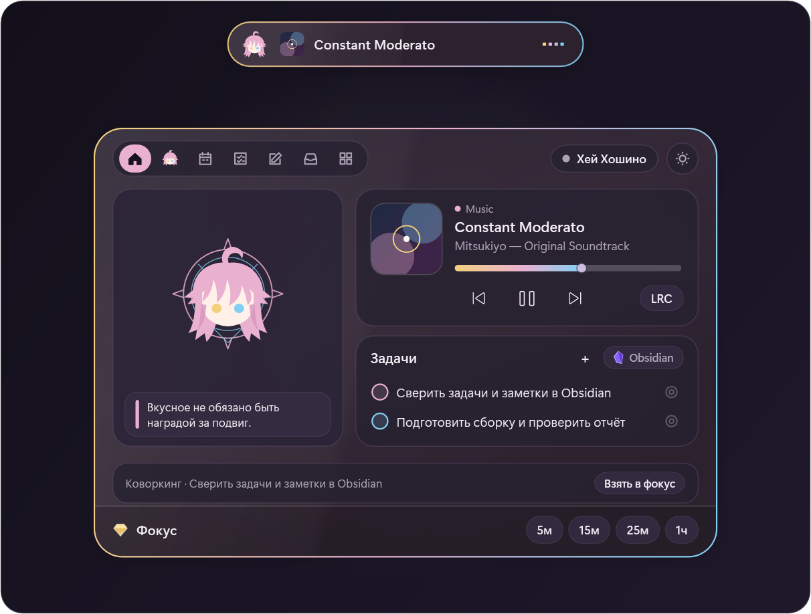
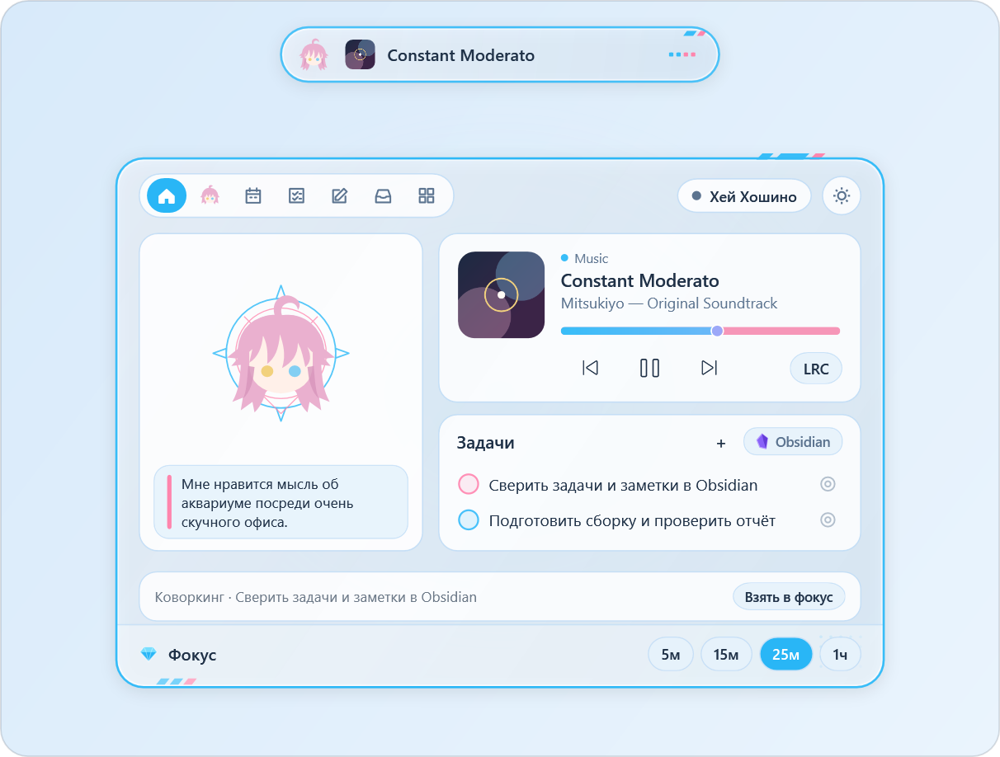
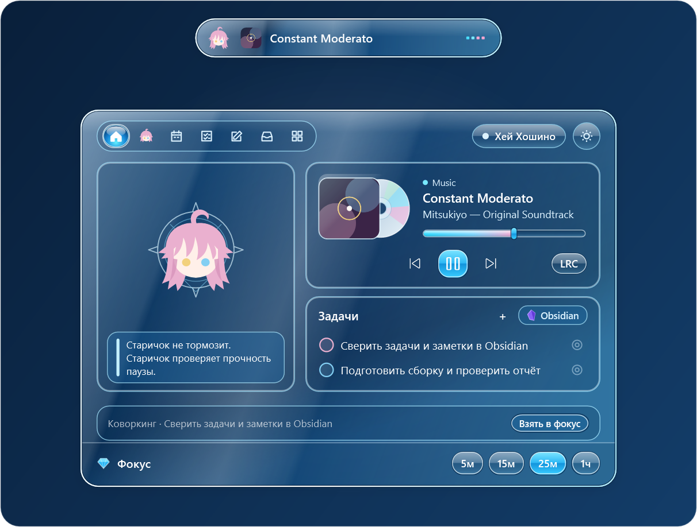
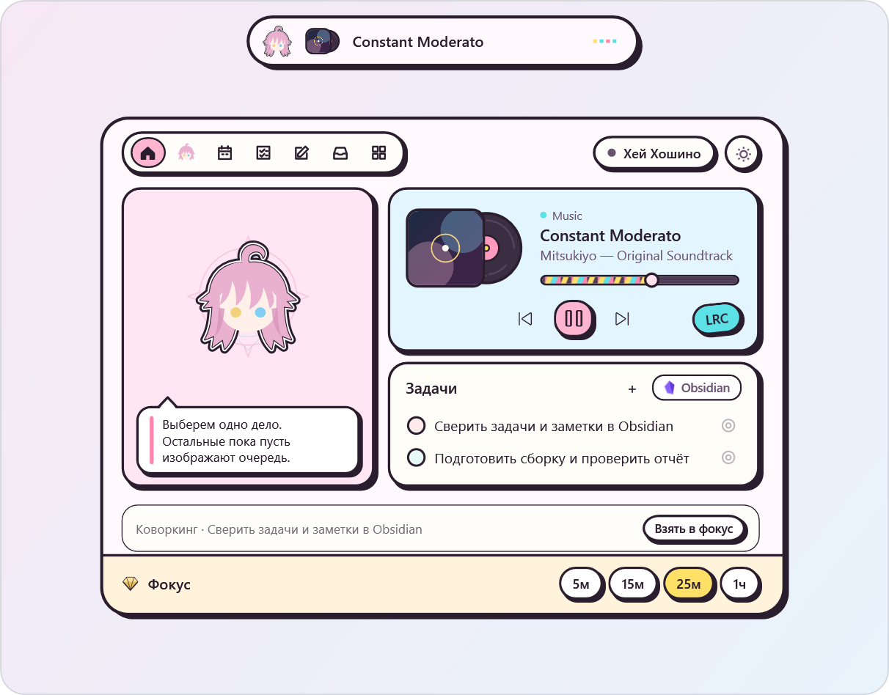
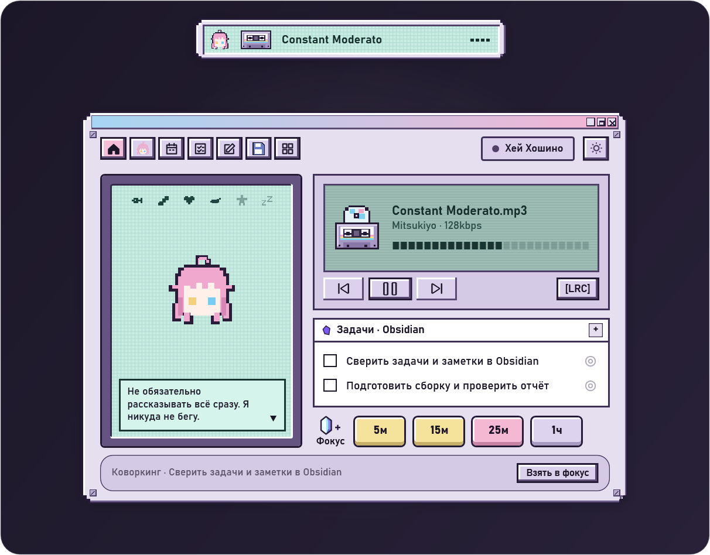
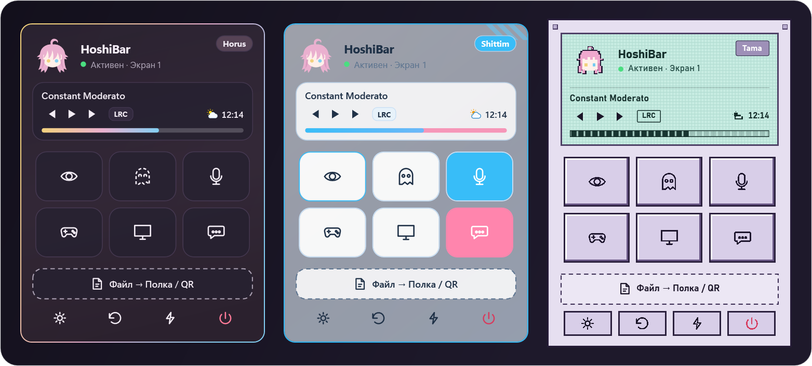
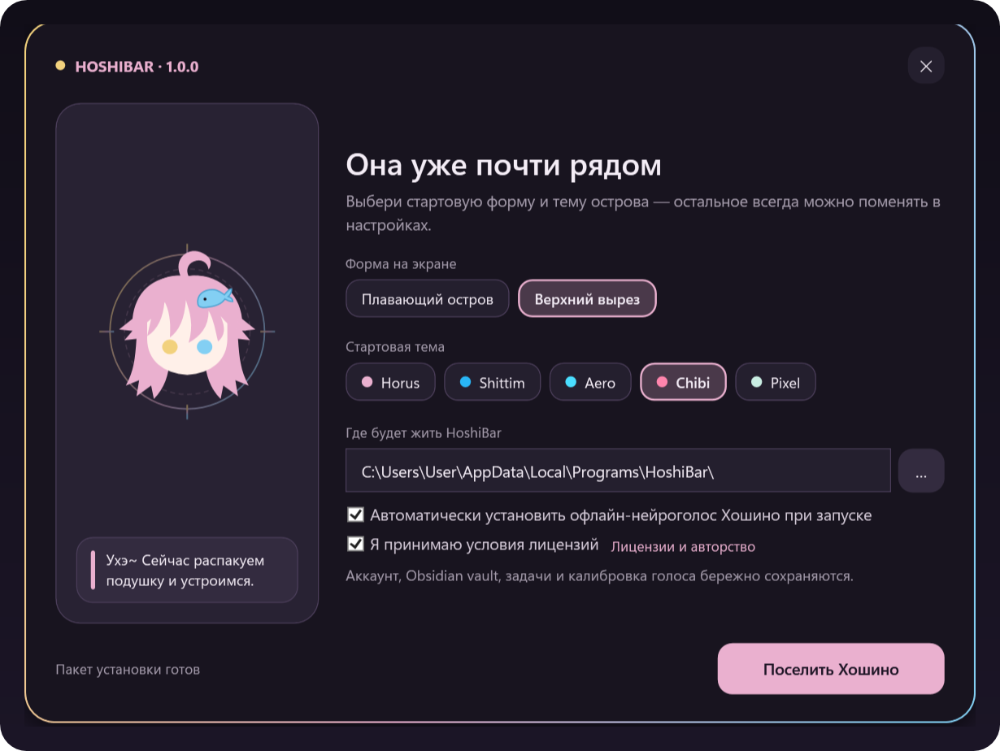

<div align="center">

# HoshiBar

**Умная верхняя панель для Windows 10/11: музыка с синхронной лирикой, задачи, Obsidian, передача файлов по Wi-Fi и локальный голосовой AI-помощник.**

[**Русский**](README.md) · [**English**](README.en.md) · [**Выпуски (Releases)**](https://github.com/Takayom1/hoshibar/releases) · [**Telegram**](https://t.me/takayom1)

</div>



**HoshiBar** — нативное настольное приложение на C# / WPF, которое располагается у верхнего края монитора в виде парящей капсулы или аккуратного выреза (`Notch`). Оно объединяет управление медиа, дела на день, заметки, переброску файлов на смартфон и ИИ-ассистента с живым векторным компаньоном в духе Таканаши Хошино (*Blue Archive*), не перегружая систему и автоматически уступая экран полноэкранным играм.

---

## Визуальные темы и форм-фактор

Интерфейс панели, окна настроек и меню в системном трее мгновенно перестраивается под одну из **5 самодостаточных тем** (а также поддерживает два режима корпуса — **Плавающий остров** и **Верхний вырез**):

- **`Horus Glass`** *(на обложке выше)* — тёмное дымчатое стекло с тонким гетерохромным кантом и 5 цветовыми палитрами (`Sakura Nap`, `Abydos Oasis`, `Yume's Compass`, `Iron Horus`, `Aquarium` + своя палитра).
- **`Shittim Chest`** — светлая матовая молочно-голубая панель в эстетике планшета *Schale OS*.
- **`Win7 Aero`** — сапфировое оптическое стекло с живым DWM-размытием, глянцевыми кнопками и CD-диском у обложки.
- **`Chibi Pop`** — плоский пастельный 2D-стиль без размытия с чётким контуром, комиксной подачей и виниловой пластинкой.
- **`Pixel Tamagotchi`** — пиксельный ретро-корпус с шапкой в духе классической Windows, матричным мятным LCD-экраном и кассетной декой.

| `Shittim Chest` | `Win7 Aero` |
| :---: | :---: |
|  |  |
| **`Chibi Pop`** | **`Pixel Tamagotchi`** |
|  |  |

---

## Основные возможности

### Музыка и синхронная лирика (`LRC`)
- Подхватывает любое активное воспроизведение в Windows через системный `GSMTC` (музыкальные плееры, стриминги и браузеры).
- Отображает обложку (включая опциональные анимированные обложки Apple Music), прогресс трека и эквалайзер в такт реальному звуку.
- Автоматически ищет синхронный текст песни (`LRCLIB`, `LyricsPlus`, `lrc.red`, `Better Lyrics`) и может выводить текущую строчку прямо на свёрнутой капсуле.

### Задачи, ежедневник и интеграция с Obsidian
- **Быстрые дела на главной** синхронизированы с полной вкладкой `To-Do` и вкладкой заметок.
- **Календарь и Markdown-дневник:** просмотр событий (системный календарь Windows и ссылки `.ics` / `webcal`) рядом с записью выбранного дня.
- **Двусторонний обмен с Obsidian:** выберите свой локальный vault — задачи, ежедневник (`YYYY-MM-DD.md`) и редактируемая память помощника хранятся в обычных `.md`-файлах с резервным копированием и защитой от конфликтов, без плагинов и облачной загрузки.

### Таймер фокуса и режим «Призрак» (`Click-Through`)
- Быстрый запуск таймера (`5м`, `15м`, `25м`, `1ч`), секундомер, будильники, привязка конкретной задачи к текущей сессии фокуса и визуальный прогресс прямо по контуру свёрнутой капсулы.
- **Режим «Призрак» (`Ctrl+Alt+G`):** делает свёрнутую панель полупрозрачной и на 100% пропускает клики и прокрутку мыши сквозь неё в верхние вкладки браузера или редактора (доступно постоянное включение и быстрый таймер на 5 минут).

### Полка файлов и локальный мост `Wi-Fi QR`
- Перетаскивайте файлы, картинки или ссылки на капсулу (или в меню трея), чтобы временно отложить их на **Полку** и вытащить в нужное окно позже.
- Кнопка **«На телефон (QR)»** поднимает временный локальный мост в домашней сети Wi-Fi на 5 минут: отсканируйте QR-код камерой смартфона, чтобы скачать выбранные файлы с ПК или отправить фото/файлы с телефона прямо на Полку без облаков и кабеля.

### AI-помощник и обновлённый нейроголос с автоустановкой
- Встроенный чат поддерживает локально установленные CLI-движков **`Codex`**, **`Gemini`** и **`Claude`** с потоковыми ответами, локальной историей и окном подтверждения потенциально опасных команд и правок файлов (`Iron Horus`).
- **Голосовое управление:** активация по фразе (**«Хей Хошино»** с быстрой калибровкой под свой микрофон) или ручная диктовка по кнопке через оффлайн-модель `Vosk` / локальный `faster-whisper` (без отправки аудиозаписей в облако).
- **Обновлённый нейроголос с автоматической установкой:** улучшенная локальная озвучка в тембре Хошино (`Silero v5_5_ru` + `HoshinoOv2 RVC v2` с детектором интонации `RMVPE`) разворачивается **полностью автоматически**. Достаточно оставить галочку в установщике (или нажать одну кнопку в разделе «Помощник AI и Голос» с выбором CPU или NVIDIA CUDA) — `HoshiBar` сам скачает и настроит изолированное окружение Python 3.11, `PyTorch`, `Applio`, `faster-whisper` и голосовые модели во внешнюю папку без ручной настройки Python.

### Настройки, системный трей и Игровой режим


- **Двухпанельное окно настроек** с живым предпросмотром капсулы, перестановкой вкладок, быстрым запуском избранных программ, погодой (`Open-Meteo`) и системными индикаторами (громкость, яркость, подключение устройств, буфер обмена, активность камеры/микрофона).
- **Иконочный Bento-пульт в системном трее** с 6 живыми состояниями иконки на панели задач, управлением треком, быстрым переключением мониторов и приёмом файлов на Полку.
- **Мультимониторность и Игровой режим:** привязка к выбранному экрану и автоматическое скрытие панели при запуске полноэкранной игры на этом мониторе (анимации останавливаются, а нейромодели голоса выгружаются из RAM/VRAM).



---

## Установка и требования



1. Скачайте актуальный установщик **`HoshiBar-Setup-*.exe`** в разделе [**Releases**](https://github.com/Takayom1/hoshibar/releases).
2. Выберите стартовую форму и тему — установщик включает `.NET 8 Runtime` и русскую оффлайн-модель речи `Vosk`, при отмеченной опции автоматически подготовит обновлённый оффлайн-нейроголос Хошино при первом запуске и бережно сохранит ваши настройки, задачи и vault при обновлениях.

**Системные требования:**
- **ОС:** Windows 10 (версия 2004 / сборка 19041+) или Windows 11 (`x64`).
- **Опционально:**
  - Для чтения системных уведомлений и календаря Windows выполните один раз регистрацию локального пакета из настроек (или `./Identity/setup-identity.ps1 -Restart`).
  - Для работы AI-чата — установленный официальный CLI выбранного провайдера (`Codex`, `Gemini` или `Claude`).
  - Отдельно ставить Python вручную не нужно: обновлённый нейроголос (`Silero` + `RVC`) и `faster-whisper` при включении устанавливаются приложением автоматически в изолированную пользовательскую папку (при желании также можно указать свои собственные модели).

---

## Сборка из исходников

Требуется **.NET 8 SDK** и **Python 3** (только для разовой загрузки официальной модели `Vosk` с проверкой SHA-256 перед сборкой):

```powershell
python scripts/prepare-speech.py
dotnet restore src/HoshiBar.csproj
dotnet build src/HoshiBar.csproj -c Release
```

Запуск собранного приложения:

```powershell
& ./src/bin/Release/net8.0-windows10.0.19041.0/HoshiBar.exe
```

---

## Технологии и хранение данных

| Компонент | Стек |
| --- | --- |
| Ядро и интерфейс | C#, .NET 8, WPF, Win32 / WinRT API, DirectComposition (`Vortice`) |
| Медиа, календарь и звук | Windows `GSMTC`, `Ical.Net`, `NAudio` |
| Речь и AI | `Vosk`, `System.Speech`, локальный мост к `faster-whisper` / `Silero` / `RVC`, JSON-RPC / CLI для `Codex`, `Gemini`, `Claude` |

Все пользовательские настройки и история лежат **вне папки установки** и не затрагиваются при обновлении:
- `%APPDATA%\DIsland\settings.json` — параметры оформления, хоткеи, будильники и виджеты;
- `%LOCALAPPDATA%\DIsland\` — локальные задачи, быстрые заметки и Полка файлов;
- `%LOCALAPPDATA%\GlassChat\` — параметры помощника, локальная история чатов, калибровка голоса, настройки и резервные копии Obsidian.

Локальные функции (медиа, задачи, синхронизация с локальным vault, передача по домашнему Wi-Fi, оффлайн-диктовка) не отправляют файлы на внешние серверы. Подробное описание сетевых запросов (погода, поиск лирики, выбранный AI-провайдер) приведено в [PRIVACY.txt](src/PRIVACY.txt).

---

## Лицензии и авторство

Самостоятельные модули **HoshiBar** распространяются по лицензии **[MIT](LICENSE-HOSHIBAR-MIT.txt)**. Унаследованные системные сервисы остаются под лицензией **[D-Island License 1.0](src/LICENSE.txt)**. Полная карта лицензий по файлам приведена в **[LICENSING.md](LICENSING.md)**, уведомления сторонних библиотек и шрифтов — в **[THIRD-PARTY-NOTICES.txt](src/THIRD-PARTY-NOTICES.txt)**.

Based on D-Island by h7 (ibuildrigs) - https://github.com/H7gamer/d-island

Модифицировано и развивается **Takayom1** — не является официальным выпуском D-Island. Персонаж Таканаши Хошино и вселенная *Blue Archive* принадлежат их законным правообладателям; проект является неофициальной фан-разработкой и не содержит игровых ассетов.

**Автор:** [Takayom1](https://github.com/Takayom1) · [Telegram](https://t.me/takayom1)
