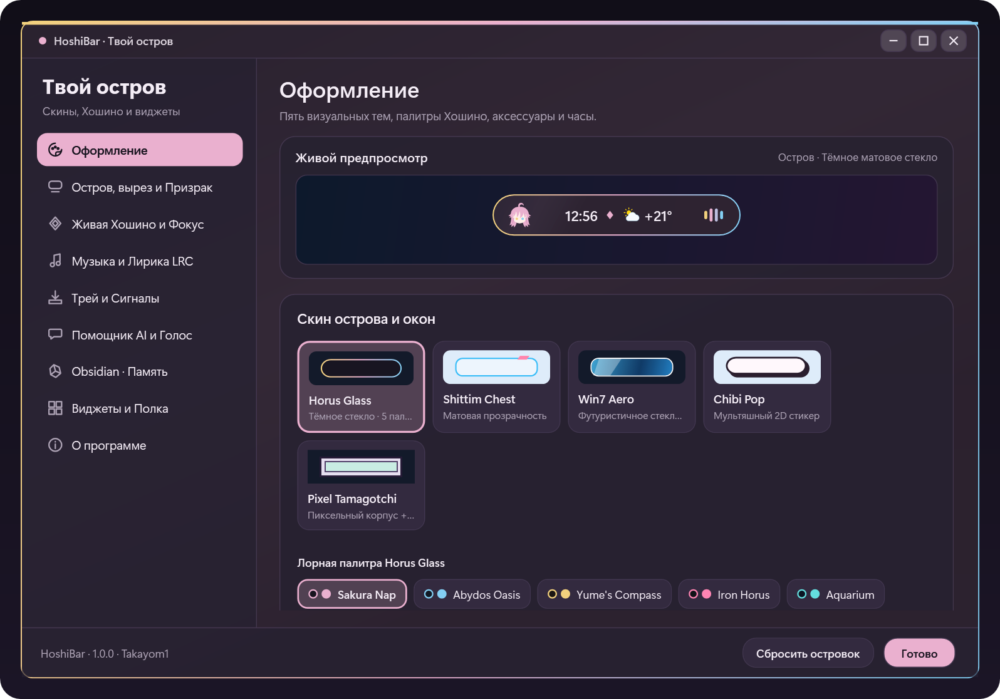

# Hoshino Island

**Маленький остров для Windows, где музыка, дела и спокойный компаньон всегда под рукой.**

Hoshino Island — настольное приложение с раскрывающейся панелью, вдохновлённое Таканаши Хошино из Blue Archive. Оно объединяет плеер, синхронную лирику, задачи, ежедневник и AI-помощника в одном месте.

Проект [Takayom1](https://github.com/Takayom1).
[Telegram](https://t.me/takayom1)



## Возможности

- **Компаньон Хошино.** Плавное движение глаз, моргание и покачивание под музыку. В разделе «О программе» нажатия переключают румянец, сердитое и обычное выражение.
- **250 авторских реплик.** Случайный порядок без повторов внутри цикла. Новая фраза появляется после закрытия раскрытого острова.
- **Музыка и лирика.** Обложка, управление воспроизведением, прогресс и автоматический поиск синхронного текста. Текущая строка может отображаться в свёрнутом островке.
- **Дела на главной.** Добавление и завершение задач без перехода в отдельное приложение, общий список с вкладкой To-Do.
- **Фокус-таймер.** Быстрый запуск таймера прямо из главной панели.
- **Календарь и ежедневник.** Компактный месяц и Markdown-запись выбранной даты рядом.
- **Obsidian.** Выбор своего vault, обмен задачами, ежедневные заметки и редактируемая память помощника.
- **AI-чат.** Официальный Codex App Server, вход через ChatGPT, потоковые ответы, локальная история, подтверждение опасных действий.
- **Настройка оформления.** Палитры, свои цвета, размеры, шрифты, плотность, Liquid Glass и уменьшение анимаций. Иконки вкладок можно переставлять.
- **Голосовой ввод и озвучивание.** Диктовка по кнопке и чтение ответа средствами Windows при наличии совместимых речевых компонентов.

Хошино здесь — авторская фан-интерпретация. Реплики не являются цитатами из игры. Приложение не связано с авторами Blue Archive.

## На чём написано

| Часть | Технология |
| --- | --- |
| Основное приложение | C#, .NET 8 |
| Интерфейс | WPF и XAML, элементы также создаются на C# |
| Системная интеграция Windows | Win32 / Windows Runtime API |
| Информация о воспроизведении | Windows Global System Media Transport Controls |
| Графика и эффекты | WPF, DirectComposition через Vortice |
| AI | Официальный Codex App Server, JSON-RPC через стандартные потоки процесса |
| Голос | System.Speech, Vosk, NAudio; опционально Python/PyTorch и Applio |
| Хранение данных | Локальные JSON-файлы и Markdown |
| Календарные источники | Windows Calendar / iCalendar, Ical.Net |

Это нативное Windows-приложение. Python нужен для подготовки модели при сборке и для дополнительных локальных нейроголосов/RVC. Базовый остров, распознавание Vosk и озвучка Windows работают без Python.

## Скачать

[Установщик Windows x64 · 0.14.1](https://github.com/Takayom1/Dynamic-insland/releases/download/v0.14.1/Hoshino-Island-Setup-0.14.1.exe) · [Все выпуски](https://github.com/Takayom1/Dynamic-insland/releases)

## Требования

- Windows 10 версии 2004 / build 19041 или новее, либо Windows 11.
- .NET 8 **Desktop Runtime** для старых framework-dependent архивов. Установщик 0.13 содержит runtime.
- .NET 8 **SDK** для сборки из исходников.
- Для AI-функций — установленный официальный Codex CLI и доступный аккаунту вход через ChatGPT.
- Для диктовки и озвучивания — совместимые распознаватель и SAPI-голос Windows нужного языка.

Без настройки AI можно пользоваться плеером, локальными задачами и другими независимыми функциями острова.

## Сборка из исходников

Откройте терминал в корне проекта:

```powershell
python scripts/prepare-speech.py
dotnet restore src/DIsland.csproj
dotnet build src/DIsland.csproj -c Release
```

Запуск:

```powershell
& ./src/bin/Release/net8.0-windows10.0.19041.0/DIsland.exe
```

Для подготовки отдельной папки приложения:

```powershell
dotnet publish src/DIsland.csproj -c Release -r win-x64 --self-contained false -o ./publish
```

Папку готовой сборки нужно переносить целиком, вместе с библиотеками, `Assets`, документами и `Identity`. Внутреннее имя запуска пока остаётся `DIsland.exe`.

## Подключение Codex

1. Установите официальный Codex CLI. При использовании npm: `npm install -g @openai/codex`.
2. Откройте настройки → **Помощник и аккаунт**.
3. Нажмите **Войти через ChatGPT**, завершите вход в браузере и нажмите **Обновить**.
4. Выберите модель и режим доступа, сохраните настройки. Если CLI не обнаружен, укажите путь к его исполняемому файлу.

Отдельный API-ключ для этого способа входа не обязателен. Доступность моделей зависит от аккаунта. Это интеграция с Codex, а не встраивание приложения ChatGPT: синхронизации с его историей нет.

Помощник предназначен для файлов, текста, Obsidian и системных задач. Его инструкции включают характер Хошино; текст можно изменить в настройках. Опасные действия требуют подтверждения, а фактические ограничения определяются выбранным режимом доступа.

## Obsidian

В настройках откройте **Obsidian · память и синхронизация**, выберите vault, настройте пути и включите подключение.

По умолчанию используются:

```text
Hoshino Island/
├── Задачи.md
├── Память.md
└── Ежедневник/
    └── YYYY-MM-DD.md
```

- Задачи проверяются на внешние изменения раз в две секунды, пока приложение работает.
- На главной и во вкладке To-Do используется один список.
- В ежедневнике запись сохраняется кнопкой; без vault он работает локально.
- Память редактируется в настройках и используется как контекст новых и возобновлённых диалогов Codex.
- Подключённый vault становится рабочей папкой помощника. Остальные права определяются режимом доступа Codex.

Задачи синхронизируются **в обозначенном разделе выбранной заметки**, а не автоматически из всех Markdown-файлов vault:

```markdown
<!-- hoshino:tasks:start -->
- [ ] Одно небольшое дело
- [x] Уже сделано
<!-- hoshino:tasks:end -->
```

Приложение добавляет к строкам служебные комментарии с ID. Сохраняйте их при редактировании; новые задачи можно писать без ID. Текст и frontmatter за пределами раздела сохраняются. Максимум — 200 задач до 300 символов каждая.

При конфликте задач автоматическая запись останавливается. Можно явно объединить оба варианта; спорные записи могут остаться отдельными задачами для ручного разбора. Перед перезаписью создаётся локальная резервная копия. Несохранённые черновики дневника при смене даты и конфликтах сохраняются вне vault.

Интеграция не устанавливает плагины Obsidian, не меняет `.obsidian` и не синхронизирует весь vault с облаком.

## Лирика и голос

Поиск лирики автоматический. Кнопка ноты у плеера управляет показом строки в свёрнутом острове и подтверждает состояние отдельным боксом. Используются LRCLIB, LyricsPlus, lrc.red и Better Lyrics/Kugou; доступность текстов зависит от источников. Если синхронизации нет, приложение не придумывает тайминги.

Диктовка запускается кнопкой микрофона, распознанный текст можно проверить перед отправкой. Озвучивание зависит от голосов Windows. В версии 0.13 добавлена активация **«Хей Хошино»**. В настройках помощника включите ожидание фразы — переключатель применяется сразу: микрофон начнёт слушать локально, а на острове появится индикатор. После фразы дождитесь сигнала и надписи «Слушаю», затем произнесите команду отдельно. После паузы распознанный текст автоматически отправится Codex. Если уже есть черновик, диктовка добавится к нему для ручной отправки.

Опасные действия остаются на подтверждении кнопкой. Ожидание приостанавливается при работе модели, озвучивании, блокировке/сне Windows. Закрытие шторки возвращает ожидание фразы; отключить его можно настройкой или нажатием на микрофонный индикатор раскрытого острова. По умолчанию постоянный микрофон выключен.

Исправление 0.14.1 задаёт UTF-8 для потокового обмена с Codex; русские ответы корректно отображаются и передаются в озвучку. Ранее искажённые ответы с однозначно восстанавливаемой кодировкой исправляются при просмотре истории.

В версии 0.14 добавлена **Калибровка · три повторения** в настройках помощника. Выберите микрофон, нажмите «Начать калибровку», дождитесь сигнала и три раза произнесите «Хей Хошино» с паузами. Индикатор показывает уровень входящего звука и число принятых повторений. После успешной калибровки ожидание и озвучка включаются, если отмечен соответствующий пункт. При слишком разных повторениях приложение попросит попробовать снова; прежний профиль сохраняется до успешной записи нового.

Три локальных шаблона произношения хранятся в `%LOCALAPPDATA%\GlassChat\wake-profile.json`. Исходные аудиозаписи не сохраняются. Это сравнение звуковых признаков фразы, не обучение голосовой модели и не проверка личности; похожий голос или запись могут вызвать активацию. «Сбросить калибровку» удаляет шаблоны. Новым пользователям нужна собственная калибровка, профиль в установщик не включён.

После активации виджеты и лирика скрываются: остаётся Хошино по центру. Этот вид сохраняется во время прослушивания команды, работы Codex, подготовки и воспроизведения голоса. По завершении возвращаются прежняя страница и настройка лирики. Нажатие на Хошино открывает чат; опасные операции по-прежнему требуют кнопочного подтверждения.

Русская диктовка использует Vosk локально. После калибровки фраза активации распознаётся локальными шаблонами без системного распознавателя Windows. Без калибровки используется Windows ru-RU или en-US. Установщик содержит русскую модель Vosk, но не устанавливает системные языковые пакеты Windows.

Озвучка: выбор установленного голоса и скорости; на ПК разработки доступна Microsoft Irina. Дополнительно можно подключить локальный Applio/RVC: укажите его Python, папку движка, .pth и .index в настройках. Самостоятельный адаптер использует безопасную загрузку checkpoint `weights_only=True`. Исполняйте только доверенный Python-движок. Модель HoshinoOv2 не включена в публичную сборку. На CPU двухсекундная тестовая фраза обрабатывалась около 68 секунд при первом запуске и 18 секунд при повторном; этот режим не является голосовым ответом в реальном времени. Длинные ответы могут упереться в трёхминутный таймаут.

### Установщик и обновления

Готовый установщик размещается в Releases как `Hoshino-Island-Setup-0.14.1.exe` вместе с `.sha256`. Он включает .NET и русскую модель Vosk, создаёт ярлыки и запись удаления программы, устанавливается для текущего пользователя. Существующие аккаунт, история, задачи и vault при обновлении/удалении не удаляются. Уведомления и календарь требуют отдельной регистрации identity по инструкции ниже.

В настройках → Обновления доступны проверка/скачивание и явная установка. Фоновые проверки не устанавливают обновления. Источник — только `Takayom1/Dynamic-insland`; установщик проверяется по SHA-256 и повторно перед запуском. Это контроль целостности, а не сертификат издателя. Установщик пока не подписан коммерческим сертификатом; Windows может показывать неизвестного издателя.

Сборка установщика: установите .NET 8 SDK, Python для подготовки модели и Inno Setup 6. Запустите `python scripts/prepare-speech.py`, затем `./scripts/build-installer.ps1 -Iscc "путь к ISCC.exe"`. Веса Vosk скачиваются с официального сайта и проверяются по закреплённому SHA-256; в Git они не хранятся.

## Уведомления и системный календарь

Этим функциям нужны разрешения Windows и регистрация package identity из папки приложения:

```powershell
./Identity/setup-identity.ps1 -Restart
```

Скрипт может запросить доверие к локальному сертификату — изучите его действия перед запуском. После переноса папки может понадобиться повторная регистрация. Внутреннее имя identity общее с D-Island; разные внешние папки под одной такой регистрацией одновременно не поддерживаются.

### Естественная речь (дополнительно, 0.13)

Кроме Windows SAPI можно выбрать локальный нейроголос Silero v5_5_ru: укажите Python окружения с torch/soundfile, модель и speaker (`baya`, `kseniya` и другие). Поддерживается проверенный официальный файл с SHA-256 `50081637b602126ee06cb3bc8a744d25651d2da149ee8864b9a379bfdd934437`, источник: https://models.silero.ai/models/tts/ru/v5_5_ru.pt . У весов отдельная CC-BY-NC-лицензия, они не входят в установщик или MIT-лицензию кода. Источник условий: https://github.com/snakers4/silero-models .

RVC необязателен и преобразует уже синтезированную речь. Проба нейроголоса через HoshinoOv2 на CPU заняла около 35 секунд для короткой реплики; первый запуск может быть дольше. Этот голос не является мгновенным full-duplex-разговором. Голосовая активация по фразе запускает одну команду, после ответа снова ждёт фразу. Пока модель отвечает или говорит, активация приостановлена.

В установленной сборке русская модель распознавания включена, а модели синтеза/персонажа и Python-движок выбираются отдельно. Это позволяет не распространять сторонние веса с неясными или некоммерческими условиями в составе приложения.

## Приватность

Локальная файловая синхронизация сама по себе не загружает vault в облако. При использовании AI сообщения, память и прочитанные помощником файлы могут передаваться OpenAI. Провайдеры лирики получают метаданные трека.

Аккаунт, история, резервные копии и личные настройки хранятся вне папки установки:

| Данные | Путь |
| --- | --- |
| Настройки острова | `%APPDATA%\DIsland\settings.json` |
| Локальные задачи | `%LOCALAPPDATA%\DIsland\notes.json` |
| Настройки AI, история, Obsidian | `%LOCALAPPDATA%\GlassChat` |
| Отдельный профиль Codex | `%LOCALAPPDATA%\GlassChat\codex` |
| Резервные копии vault | `%LOCALAPPDATA%\GlassChat\vault-backups` |
| Черновики дневника | `%LOCALAPPDATA%\GlassChat\journal-drafts` |

Не добавляйте эти папки в репозиторий или архив приложения. Подробности: [PRIVACY.txt](src/PRIVACY.txt).

## Структура проекта

```text
src/                 WPF-приложение, ресурсы и документы зависимостей
docs/screenshots/    Иллюстрации README
LICENSE-HOSHINO-MIT.txt
LICENSING.md
README.md
```

Временные сборки, `work`, `outputs`, `bin` и `obj` не предназначены для публикации исходников.

## Статус

Проект находится в активной разработке. Интерфейс и локальная синхронизация проверялись отдельно, включая временный vault и конфликты файлов. Поддержка конкретных плееров, голосовых компонентов, календарей и моделей может различаться. Вход и выполнение реальной задачи моделью требуют проверки на вашем аккаунте.

## Лицензии и авторство

Самостоятельные компоненты Hoshino Island распространяются под [MIT](LICENSE-HOSHINO-MIT.txt). Унаследованные части остаются под [D-Island License 1.0](src/LICENSE.txt). Точная область действия указана в [LICENSING.md](LICENSING.md); вся сборка не является целиком MIT.

Based on D-Island by h7 (ibuildrigs) - https://github.com/H7gamer/d-island

Изменено Takayom1 с помощью Codex. Не является официальным выпуском D-Island. Условия сторонних библиотек перечислены в [THIRD-PARTY-NOTICES.txt](src/THIRD-PARTY-NOTICES.txt). Права на Blue Archive и персонажа принадлежат их правообладателям.

**Takayom1** · [GitHub](https://github.com/Takayom1) · [Telegram](https://t.me/takayom1)
